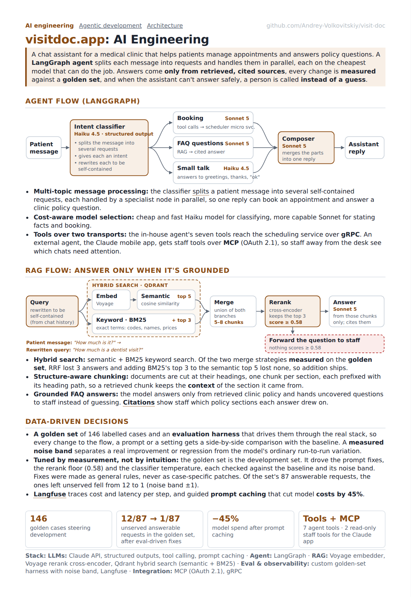
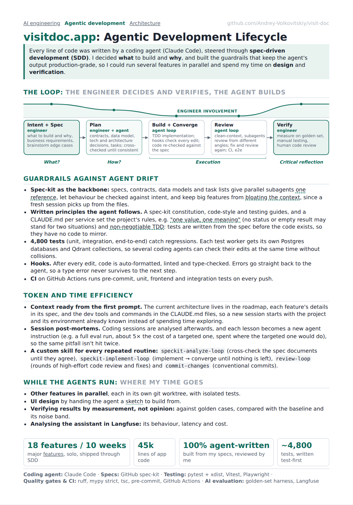
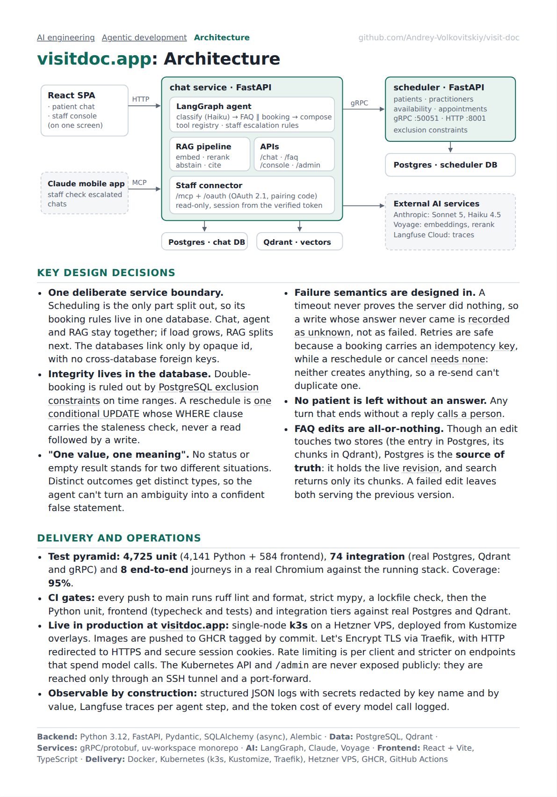
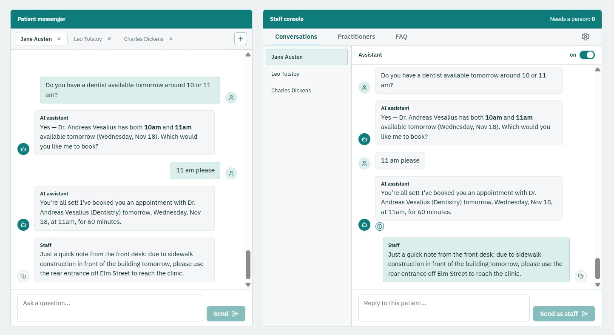

# VisitDoc
**A conversational AI assistant** for medical clinics. It helps patients book, reschedule and
cancel appointments through chat and get grounded answers to policy/FAQ questions. When the
assistant can't answer reliably (for example, the question isn't covered by the clinic's FAQ), it
escalates to staff rather than guessing, so patients only get information they can trust.

## Under the hood

VisitDoc is a portfolio project, and each of these one-page overviews looks under its hood from a
different angle: the **AI engineering** behind the assistant (agent flow, RAG, evaluation), the
**agentic development lifecycle** it was built with, and the system **architecture** that runs it in
production.

<table>
<tr><th width="33%"><a href="https://andrey-volkovitskiy.github.io/visit-doc/portfolio-ai-engineering.html">AI Engineering</a></th><th width="33%"><a href="https://andrey-volkovitskiy.github.io/visit-doc/portfolio-adlc.html">ADLC</a></th><th width="33%"><a href="https://andrey-volkovitskiy.github.io/visit-doc/portfolio-architecture.html">Architecture</a></th></tr>
<tr><td></td><td></td><td></td></tr>
</table>

**Built with:** Python · FastAPI · Claude (Anthropic API) · LangGraph · hybrid RAG on Qdrant (Voyage
embeddings + BM25, Voyage rerank) · PostgreSQL · gRPC · React + Vite · Langfuse · MCP · Docker ·
Kubernetes (k3s)

**Evaluated on** a 146-case golden set: every change is compared against a committed baseline and
measured run-to-run noise rather than a single score.

## Try it live
**Open [visitdoc.app](https://visitdoc.app)**, no sign-up needed.

Since this is a demo, the screen is split into **two panels**, so you can watch the assistant at work
from both sides of the conversation: as a patient and as clinic staff. Staff can follow patient
chats as they happen, edit practitioners' schedules and the FAQ, and take over from the assistant
when needed.

## Installation

See [`docs/getting-started.md`](docs/getting-started.md): the repository layout, installing,
configuring, running the app locally, and running the tests.
